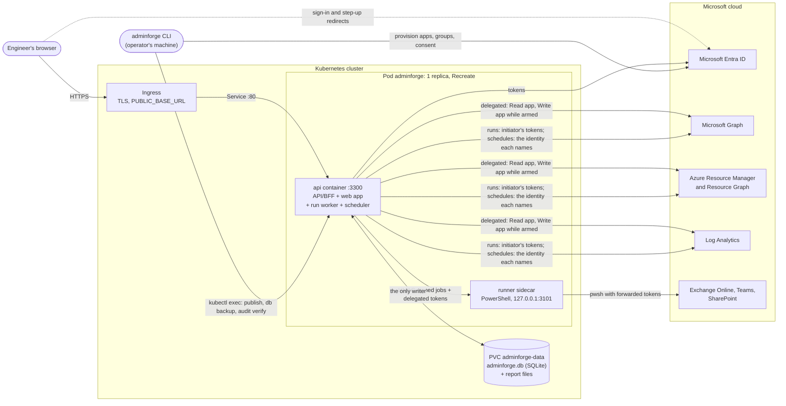

# Architecture (as deployed)

How AdminForge runs: one pod on Kubernetes — the API process, which is also the run worker and the scheduler, plus the
PowerShell runner as a sidecar — with all state in one SQLite file on a PersistentVolume (ADR-016, ADR-017). Why it is
built this way is in [`docs/adr/`](adr/); the security model is in [`SECURITY.md`](../SECURITY.md); installation is in
[`portal/deploy/kubernetes/README.md`](../portal/deploy/kubernetes/README.md) and day-to-day operation in
[`docs/operations.md`](operations.md).

## The pod

| Container or process | Entry                                                             | Listens on                      | What it does                                                                                                                                                                                                                                                                                                                                                                                                                                                                               |
| -------------------- | ----------------------------------------------------------------- | ------------------------------- | ------------------------------------------------------------------------------------------------------------------------------------------------------------------------------------------------------------------------------------------------------------------------------------------------------------------------------------------------------------------------------------------------------------------------------------------------------------------------------------------ |
| `api`                | `portal/apps/api` → `dist/main.js` (image `adminforge`)           | `:3300` (Service `adminforge`)  | The backend-for-frontend: serves the built web app, `/auth/*` (sign-in, arming), every `/api` route, `/healthz` and `/readyz`; holds sessions and tokens, runs datasources, streams live updates (SSE), serves report downloads. Also the **run worker** (consumes the `run_jobs` queue, `RUN_WORKER_CONCURRENCY`, default 8, including the runs schedules start; at most `RUN_MAX_OPEN_PER_USER`, 5, open runs per person) and the **scheduler** (below). Migrates the database at start. |
| `runner` (sidecar)   | `portal/apps/runner` → `dist/main.js` (image `adminforge-runner`) | `127.0.0.1:3101` (pod loopback) | PowerShell for Exchange, Teams and SharePoint: pinned scripts in single-use `pwsh` workers. Gets only `RUNNER_SHARED_KEY`; never mounts the volume.                                                                                                                                                                                                                                                                                                                                        |
| `adminforge` CLI     | `portal/tools/cli` → `dist/adminforge.js` (app image)             | —                               | `kubectl exec deploy/adminforge -c api -- adminforge …`: `publish`, `audit verify`, `db backup`, `env check`. Opens the same file beside the API (WAL mode, `DATABASE_BUSY_TIMEOUT_MS`).                                                                                                                                                                                                                                                                                                   |
| Scheduler one-shots  | `portal/apps/scheduler` → `dist/main.js` (app image)              | —                               | `--once`, `--probe <key>`, `--schedule <key>`: probes or one schedule now, as the automation identity. A playbook run they start is queued for the API's worker.                                                                                                                                                                                                                                                                                                                           |

The base manifests (`portal/deploy/kubernetes/base`) fix the pod's layout in a ConfigMap that wins over the
installation's Secret: `NODE_ENV=production`, `API_HOST=0.0.0.0`, `API_PORT=3300`,
`DATABASE_PATH=/var/lib/adminforge/adminforge.db`, `ADMINFORGE_ARTIFACTS_DIR=/var/lib/adminforge/artifacts`,
`CONTENT_SOURCE=db` and `RUNNER_URL=http://127.0.0.1:3101`. There is one replica with `strategy: Recreate`: SQLite has
one writer and the volume is ReadWriteOncePod, so a deploy is a short outage. Both containers run non-root with a
read-only root file system, no capabilities and no service-account token; a NetworkPolicy allows ingress to port 3300
and egress to the cluster's DNS and to public addresses on 443 — private and reserved ranges, the cloud metadata
service included, are refused, and the overlay names the private addresses an installation needs (`SECURITY.md` →
Deployment, storage and network). Both images start from bases pinned by digest.

## Request paths

**Reading.** The browser holds only an HttpOnly session cookie (`__Host-adminforge` in production). The API resolves
the session from the database, re-reads the person's roles from Entra every 5 minutes, and renders the page's
datasources from published content. Every outbound call passes the default-deny request policy (only reads leave the
API in read mode), gets a delegated **Read** app token from the sealed MSAL cache, and carries the request's
correlation id to Microsoft. Tokens never reach the browser. Outbound calls are limited per service and per user
(`OUTBOUND_CONCURRENCY`, `OUTBOUND_USER_CONCURRENCY`) and time out after `OUTBOUND_TIMEOUT_MS`.

**Writing.** An Operator arms write access: a second sign-in to the **Write** app with step-up (a Conditional Access
authentication context when `WRITE_AUTH_CONTEXT` is set, otherwise a fresh sign-in proven by `auth_time`); arming
moves the session to a new id and CSRF token, so a cookie copied while read-only never carries write access. The write
window lasts `WRITE_SESSION_MAX_MINUTES` (default 60) with one extension. Writes exist only as `mode: write` steps in
published playbooks: the engineer previews (a dry run), confirms, and the API queues the run. The run worker executes
it with the initiator's delegated tokens (Write tokens only while armed; a run whose write window ended, or that was
started before the session was armed, pauses until the person arms and resumes it). Steps after an approval run as the
approver. A restart doesn't end a run: it stops at a checkpoint, its job is queued again and the next process resumes
it (a step in flight is retried, or the run ends `needs_review` if it is `idempotent: false`). A run that paused —
for any of these reasons — reads and checks again before its next write (`engine.ts` › `recheck`). Someone else's
delegated run is shown as metadata — what ran, who, when, status — unless the viewer approves it or is a Portal Admin
(S-25). The worker is part of the API process, so run events reach the browser's SSE stream directly.

**PowerShell.** Exchange, Teams and SharePoint work goes to the runner on the pod's loopback. The API mints delegated
tokens for the services the script declares, seals them (AES-256-GCM, bound to the job id and request timestamp) and
sends a job with a fresh nonce, signed with HMAC over timestamp, method, path and body hash (±60 seconds); all keys are
derived from `RUNNER_SHARED_KEY` with HKDF-SHA256. The runner only runs scripts from `portal/content/scripts` whose
SHA-256 matches, opens the tokens for a single-use `pwsh` worker (stdin), and signs every event of its answer over the
nonce; the API verifies each event before using it and refuses redirects. In read mode the worker first checks the
script against a static read-only policy, then guards every write command of the loaded service modules and turns
module auto-loading off.
Scheduled scripts aren't supported yet: the runner can't sign in as the automation identity (`docs/backlog.md`).

**Schedules.** The scheduler runs in the API process and fires schedules (`SCHEDULER_CONCURRENCY`, default 4) only while
it holds the `adminforge.scheduler` lease (30 seconds, renewed every 5), so no second process fires them on their
timetable too; a one-shot runs the schedule or probes it was asked for, without the lease. Probe, report and
content-health jobs only read, as the identity the schedule names (ADR-014: the automation identity by default, a named
app identity, or — report schedules made in the portal — their creator's own access) — except the built-in synthetic
transactions, which write only to configured test objects (ADR-015); playbook jobs are queued for the run worker, which
runs them as the automation identity (under the app identity's name when the schedule names one). Probe results (status,
metric, a message and the detail rows behind it) go to `probe_results`, each run to `schedule_runs`, and report files to
`ADMINFORGE_ARTIFACTS_DIR` (in the pod `/var/lib/adminforge/artifacts`, on the same volume as the database; in
development `~/.local/share/adminforge/artifacts`) as `<schedule>/<timestamp>.<ext>`, which the API serves to
`Portal.Operator` by default. `GET /api/probes` gives every Reader each probe's latest result with its definition's
`summary`, `remedy` and `link`; a probe's detail on Synthetic monitoring reads `GET /api/probes/:key/results`, whose
detail rows only Operators receive (others get `detailsHidden`). Write-capable schedules run only after a second person
approved enabling them; the approval covers a fingerprint of the playbook and its children, so publishing a new version
switches the schedule off until it is approved again.

A time the scheduler missed by more than an hour (the pod was down that long) is not run late: it becomes a `skipped`
run with `schedule_missed`, dated when it was due, audited, and shown as the schedule's last run. **Run now** on a
disabled schedule (or one disabled before the run started) runs the job but only writes its file — no email, Teams post
or notification until the schedule is enabled; the scheduler's `--schedule` one-shot delivers as configured. A run that
reaches `timeoutSeconds` is recorded at once and sends nothing more, but its slot (and its schedule's overlap policy)
stays taken until the job itself ends, at most two minutes more.

## Health and housekeeping

`/healthz` answers whenever the process is up (the container's liveness). `/readyz` also reads the database and the
**heartbeats** in `settings`: `ok`, `degraded` (still 200: the API serves, but the scheduler or the run worker isn't
working) or 503 `not_ready`. The scheduler beats from its ticks — after each one that went through while it holds the
lease — so a scheduler whose ticks fail goes stale after two minutes although the process answers; `GET
/api/schedules` reports the same (`scheduler: { state, at }`). The run worker beats from its queue polls — after each
one that went through — so a worker whose polls fail goes stale the same way. Both write at most every 30 seconds.

Every 10 minutes the API removes expired sessions' tokens, sign-in round trips and signals older than an hour; every 6
hours it applies **retention** (`RETENTION_*`). Each purge — report files and News and changes items included —
deletes 2,000 rows (files) per batch and lets the event loop run between batches, a pass stops after 2 seconds and
continues at the next 10-minute pass (report files from where it stopped), and the freed pages go back to
the file system in steps (`incremental_vacuum`) — better-sqlite3 is synchronous, so housekeeping never holds HTTP, runs
or schedules for long. The audit log is never purged; `probes.audit-chain` checks it hourly from the last verified
checkpoint and walks the whole chain at start, once a day and after any break it found. An event older than the
checkpoint that changed is found by the next full walk (or the Audit page, or `adminforge audit verify`).

## Identities

Provisioned by `pnpm adminforge provision entra` (idempotent). Portal roles are app roles on the Read app, granted
through `SG-AdminForge-<label>-<Role>` groups (`docs/access.md`).

| Identity                          | Kind                                | Used by                                                 | What it can do                                                                                                                                                                                                                                                                                  |
| --------------------------------- | ----------------------------------- | ------------------------------------------------------- | ----------------------------------------------------------------------------------------------------------------------------------------------------------------------------------------------------------------------------------------------------------------------------------------------- |
| AdminForge Read `[<label>]`       | Delegated                           | API and its run worker, for everyone with a portal role | Read as the signed-in person. Assignment required (the portal-role groups). Azure's only delegated scope is the coarse `user_impersonation`, so the request policy keeps this read-only.                                                                                                        |
| AdminForge Write `[<label>]`      | Delegated                           | API and its run worker, for Operators while armed       | Change data as the signed-in person, within their own Entra and Azure roles. Assigned to the Operator group only, so Entra refuses everyone else.                                                                                                                                               |
| AdminForge Automation `[<label>]` | Application (certificate or secret) | Scheduler and scheduled runs                            | Read-only application permissions by default; write permissions declared by content are granted only with `AF_AUTOMATION_ALLOW_WRITE_PERMISSIONS=true`, sensitive reads and tier-0 permissions only with their own opt-ins as well (`docs/access.md`). Reader on `AF_SUBSCRIPTION_ID` when set. |
| Provisioner                       | Application (created by you)        | `adminforge provision …` only, on an operator's machine | Creates and updates the apps, groups, consent and Azure role assignments. Its credentials live in `<env>.admin.env`, which never reaches the cluster.                                                                                                                                           |

AdminForge adds restrictions, never privileges: a delegated call can't do more than the person could do in the
Microsoft admin centers.

## Data

All state is one SQLite file, `DATABASE_PATH` (ADR-016): better-sqlite3 in WAL mode, owned by the API process. Schema:
`portal/apps/api/src/db/schema.ts`; migrations: `portal/apps/api/drizzle/`, applied by the API at start. Write
transactions are synchronous `BEGIN IMMEDIATE` (`writeTx`), so writers are serialised, also across processes.

| Area         | Tables                                                           | Notes                                                                                                                                                                                                                                       |
| ------------ | ---------------------------------------------------------------- | ------------------------------------------------------------------------------------------------------------------------------------------------------------------------------------------------------------------------------------------- |
| Sign-in      | `sessions`, `preauth`, `token_cache`                             | Only the session id's hash is stored; the MSAL cache is sealed with AES-256-GCM (`TOKEN_CACHE_KEY`). Deleted rows are overwritten (`secure_delete`).                                                                                        |
| Content      | `definitions`                                                    | Published versions (key, version, SHA-256, content schema version); `publish` sends the `definitions_changed` signal. Each row is re-validated against its kind's schema when loaded; one that fails is refused (`definition_unavailable`). |
| Runs         | `runs`, `run_steps`, `run_step_events`, `approvals`, `run_jobs`  | `run_jobs` is the queue: at most one queued and one active job per run, leases, retries with backoff. Show-once secrets stay in the API's memory, never in the file.                                                                        |
| Schedules    | `schedules`, `schedule_grants`, `schedule_runs`, `probe_results` | Schedules are synced from content; a one-shot's events reach browsers through the `schedule_events` signal.                                                                                                                                 |
| News         | `news_items`, `news_feed_state`                                  | News and changes: one row per source item (headline, short excerpt, citation, facts) and per feed (last run, ETag).                                                                                                                         |
| Audit        | `audit_events`                                                   | Append-only (SQLite triggers), hash-chained — HMAC-keyed from a cut-over once `AUDIT_CHAIN_KEY` is set; `correlation_id` ties events to the Reference users see. The chain's checkpoints in the container log detect tampering.             |
| Preferences  | `user_prefs`, `settings`, `saved_views`                          | Theme, density, pins; appearance; saved table views.                                                                                                                                                                                        |
| Coordination | `signals`, `leases`                                              | Signals between processes (they replace Postgres LISTEN/NOTIFY; kept an hour) and named leases (the scheduler's leadership, per-run locks).                                                                                                 |

The triggers stop the application rewriting history; they don't stop someone who can write the volume — SQLite has no
roles, so the file is guarded instead (0600, local block storage only; `SECURITY.md`).

Outside the database: the `adminforge-env` Secret (made from the env file: `TOKEN_CACHE_KEY`, `AUDIT_CHAIN_KEY`, the
apps' credentials), report files (on the same volume) and the automation certificate. Back up the volume (snapshots,
`adminforge db backup`) and the Secret separately (`portal/deploy/kubernetes/README.md` → Backups).

## Content flow

Pages, dashboards, reports, playbooks, runbooks, schedules, probes and connections are YAML in `portal/content`
(ADR-005), rendered and executed by generic code:

1. Author in git with Claude Code (`CLAUDE.md`, `.claude/skills/`, `docs/extending.md`).
2. `pnpm adminforge validate` checks schema, references (including probe links to pages), expressions, query lint
   (quoting; Resource Graph join and union limits) and env keys (`--scopes` also compares declared permissions with
   the app registrations); `pnpm adminforge test` runs playbook tests.
3. The reviewed content ships in the app image (`build-images.sh` records whether it was reviewed). In the pod,
   `adminforge publish` writes new versions to the `definitions` table (idempotent by SHA-256; it refuses a changed
   file whose `version` wasn't bumped) and sends the `definitions_changed` signal.
4. The API (`CONTENT_SOURCE=db`) drops those cache entries within a second (it polls the `signals` table) and the
   scheduler re-syncs the `schedules` table — no restart. Interactive runs always use the current published version.

In development, `CONTENT_SOURCE=fs` (the default outside production) serves `portal/content` from disk with hot reload.

## Configuration

Nothing tenant-specific is in git. Every key is documented in `config/example.env`. On a workstation, real values live
in `~/.config/adminforge/` (mode 700, files mode 600: the API and the CLI — all but `env check` — refuse an env file
other users can read, and name the `chmod`); `portal/packages/config/src/index.ts` layers the files, lowest precedence
first:

| Layer | File                                    | Read by                                                    | Holds                                                                                                                            |
| ----- | --------------------------------------- | ---------------------------------------------------------- | -------------------------------------------------------------------------------------------------------------------------------- |
| 1     | `<env>.env` (or `$ADMINFORGE_ENV_FILE`) | API, scheduler one-shots, CLI, `pnpm dev`                  | Runtime settings and app credentials. `<env>` is `$ADMINFORGE_ENV`, default `dev`.                                               |
| 2     | `<env>.admin.env`                       | `provision …`, `validate --scopes` and the live tests only | Provisioner and live-test credentials. The API drops these keys even if they appear in layer 1.                                  |
| 3     | `<env>.$ADMINFORGE_ENV_OVERLAY.env`     | Processes that set the overlay                             | Per-deployment overrides.                                                                                                        |
| 4     | Process environment                     | Everyone                                                   | In the pod, everything: the `adminforge-env` Secret and the `adminforge-config` ConfigMap (the ConfigMap wins). CI. Always wins. |

Empty values count as unset. The runner reads only its process environment: in the pod `RUNNER_SHARED_KEY` from the
Secret, `RUNNER_HOST` and `RUNNER_PORT`. `pnpm adminforge env check` reports key names and states, never values, and
names keys of the Postgres releases (`DATABASE_URL`, `RUN_WORKER_IN_PROCESS`, …) so you can remove them.

`pnpm dev` uses a database file of its own; the cluster's file is on a volume only the pod can mount.

| Setting               | `pnpm dev`                                                                | Kubernetes                                                        |
| --------------------- | ------------------------------------------------------------------------- | ----------------------------------------------------------------- |
| Address people open   | `http://localhost:5173` (Vite proxies `/api` and `/auth`)                 | `PUBLIC_BASE_URL`, the Ingress (`https://adminforge.example.com`) |
| API                   | `API_PORT=3001` on `127.0.0.1`                                            | `API_PORT=3300` on the pod's interface                            |
| Content               | `CONTENT_SOURCE=fs`, hot reload                                           | `CONTENT_SOURCE=db`, published versions                           |
| Run worker, scheduler | In the API process                                                        | In the API process                                                |
| Database              | `~/.local/share/adminforge/dev.db` (`init:local`); in memory in mock mode | `/var/lib/adminforge/adminforge.db` on the PVC                    |

Sign-in works only on `PUBLIC_BASE_URL`: Entra redirect URIs are built from it, and every extra origin must be listed
in `AF_REDIRECT_BASE_URLS` and registered with `pnpm adminforge provision entra`. Any address other than `localhost`
must be HTTPS, because the production session cookie is `__Host-` and `Secure`.

## Decisions

| ADR                                                 | Decision                                                                              |
| --------------------------------------------------- | ------------------------------------------------------------------------------------- |
| [001](adr/001-bff-token-custody.md)                 | The backend holds all tokens; the browser holds only a session cookie.                |
| [002](adr/002-read-write-app-split.md)              | Separate Read and Write app registrations; write needs step-up.                       |
| [003](adr/003-default-deny-request-policy.md)       | Default-deny outbound request policy.                                                 |
| [004](adr/004-postgres-only-state.md)               | Postgres is the only stateful dependency. Superseded by 016.                          |
| [005](adr/005-declarative-content.md)               | Declarative YAML content with JSONata expressions.                                    |
| [006](adr/006-powershell-runner.md)                 | PowerShell runner with single-use workers.                                            |
| [007](adr/007-design-tokens.md)                     | Design tokens in TypeScript compiled to CSS variables.                                |
| [008](adr/008-host-first-hosting.md)                | Run on this host first; Azure optional. Superseded by 017.                            |
| [009](adr/009-secretless-where-possible.md)         | Configuration outside the repo; secretless in Azure (not yet implemented).            |
| [010](adr/010-runs-need-live-identity.md)           | Interactive runs use the engineer's identity.                                         |
| [011](adr/011-automation-identity-for-schedules.md) | Unattended schedules use an automation identity.                                      |
| [012](adr/012-extend-with-claude-code.md)           | Extend AdminForge with Claude Code, not an in-app AI assistant.                       |
| [013](adr/013-news-feed-egress.md)                  | Public news feeds come only from an allow-list of hosts kept in code.                 |
| [014](adr/014-schedule-identities.md)               | A schedule runs as the automation identity, a named app registration, or its creator. |
| [015](adr/015-synthetic-transactions.md)            | Synthetic transactions are built-in probes that write only to test objects.           |
| [016](adr/016-sqlite-on-a-persistent-volume.md)     | One SQLite file on a persistent volume holds all state; one process owns it.          |
| [017](adr/017-kubernetes-one-pod.md)                | Kubernetes, one pod: one replica, `Recreate`, the runner as a sidecar.                |

More: `docs/decisions.md` (decision log), `docs/troubleshooting.md` (error codes), `docs/backlog.md` (known gaps).
