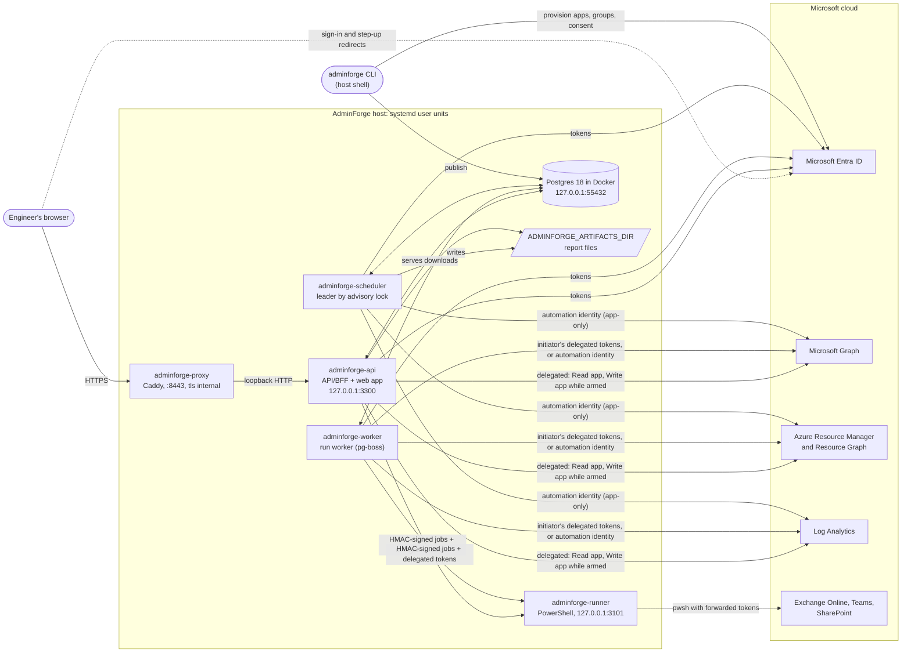

# Architecture (as deployed)

How AdminForge runs today: one host, five systemd **user** units and a Postgres container. Why it is built this way is
in [`docs/adr/`](adr/); the security model is in [`SECURITY.md`](../SECURITY.md); installation is in
[`portal/deploy/README.md`](../portal/deploy/README.md) and day-to-day operation in
[`docs/operations.md`](operations.md).

## Processes

| Unit                   | Entry                                    | Listens on        | What it does                                                                                                                                                                                                                                    |
| ---------------------- | ---------------------------------------- | ----------------- | ----------------------------------------------------------------------------------------------------------------------------------------------------------------------------------------------------------------------------------------------- |
| `adminforge-proxy`     | Caddy (`~/.config/adminforge/Caddyfile`) | `:8443` (HTTPS)   | TLS for the LAN with its own CA (`tls internal`), admin API off, no root; proxies to `127.0.0.1:3300`.                                                                                                                                          |
| `adminforge-api`       | `portal/apps/api` → `dist/main.js`       | `127.0.0.1:3300`  | The backend-for-frontend: serves the built web app, `/auth/*` (sign-in, arming), every `/api` route, `/healthz` and `/readyz`. Holds sessions and tokens, runs datasources, enqueues runs, streams live updates (SSE), serves report downloads. |
| `adminforge-worker`    | `portal/apps/api` → `dist/worker.js`     | —                 | Consumes the pg-boss run queue and executes playbook and runbook steps (`RUN_WORKER_CONCURRENCY`, default 4), including the runs that schedules start.                                                                                          |
| `adminforge-scheduler` | `portal/apps/scheduler` → `dist/main.js` | —                 | Runs content schedules as the automation identity: probe sweeps (including KQL configuration checks), report exports, scheduled playbooks (handed to the worker) and content health. One leader at a time; others stand by.                     |
| `adminforge-runner`    | `portal/apps/runner` → `dist/main.js`    | `127.0.0.1:3101`  | PowerShell for Exchange, Teams and SharePoint: pinned scripts in single-use `pwsh` workers.                                                                                                                                                     |
| Postgres (Docker)      | `portal/deploy/docker-compose.dev.yml`   | `127.0.0.1:55432` | All application state (below). Started with `pnpm db:up`.                                                                                                                                                                                       |

The repository's units (`portal/deploy/systemd/*.service`) carry the entry points; a per-host drop-in sets
`NODE_ENV=production`, `API_PORT=3300`, `PUBLIC_BASE_URL`, `CONTENT_SOURCE=db`, `RUN_WORKER_IN_PROCESS=false` and
`SCHEDULER_IN_PROCESS=false`, and the API binds to `127.0.0.1` by default (`API_HOST`). Every unit can also take the
`hardening.conf` drop-in (seccomp-based restrictions).

## Request paths

**Reading.** The browser holds only an HttpOnly session cookie (`__Host-adminforge` in production). The API resolves
the session from Postgres, re-reads the person's roles from Entra every 5 minutes, and renders the page's datasources
from published content. Every outbound call passes the default-deny request policy (only reads leave the API in read
mode), gets a delegated **Read** app token from the sealed MSAL cache, and carries the request's correlation id to
Microsoft. Tokens never reach the browser. Outbound calls are limited per service and per user
(`OUTBOUND_CONCURRENCY`, `OUTBOUND_USER_CONCURRENCY`) and time out after `OUTBOUND_TIMEOUT_MS`.

**Writing.** An Operator arms write access: a second sign-in to the **Write** app with step-up (a Conditional Access
authentication context when `WRITE_AUTH_CONTEXT` is set, otherwise a fresh sign-in proven by `auth_time`). The write
window lasts `WRITE_SESSION_MAX_MINUTES` (default 60) with one extension. Writes exist only as `mode: write` steps in
published playbooks: the engineer previews (a dry run), confirms, and the API enqueues the run. The worker executes it
with the initiator's delegated tokens (Write tokens only while armed; a run whose write window ended pauses until the
person arms again). Steps after an approval run as the approver. Run events go back to the browser through Postgres
`NOTIFY run_events` and the API's SSE stream.

**PowerShell.** Exchange, Teams and SharePoint work goes to the runner on loopback. The API or worker mints delegated
tokens for the services the script declares and sends a job signed with HMAC over timestamp, method, path and body
hash (`RUNNER_SHARED_KEY`, ±60 seconds). The runner only runs scripts from `portal/content/scripts` whose SHA-256
matches, hands the tokens to a single-use `pwsh` worker over stdin, and in read mode allows only Get-\* cmdlets.
Scheduled scripts aren't supported yet: the runner can't sign in as the automation identity (`docs/backlog.md`).

**Schedules.** Each scheduler process campaigns for a Postgres advisory lock; the holder fires schedules
(`SCHEDULER_CONCURRENCY`, default 4) and a standby takes over within seconds if it stops. Probe, report and
content-health jobs only read, as the automation identity; playbook jobs are handed to the worker, which runs them as
the automation identity. Probe results go to `probe_results`, each run to `schedule_runs`, and report files to
`ADMINFORGE_ARTIFACTS_DIR` (default `~/.local/share/adminforge/artifacts`) as `<schedule>/<timestamp>.<ext>`, which
the API serves to `Portal.Operator` by default. Write-capable schedules run only after a second person approved
enabling them; the approval covers a fingerprint of the playbook and its children, so publishing a new version
switches the schedule off until it is approved again.

## Identities

Provisioned by `pnpm adminforge provision entra` (idempotent). Portal roles are app roles on the Read app, granted
through `SG-AdminForge-<label>-<Role>` groups (`docs/access.md`).

| Identity                          | Kind                                | Used by                                         | What it can do                                                                                                                                                                                   |
| --------------------------------- | ----------------------------------- | ----------------------------------------------- | ------------------------------------------------------------------------------------------------------------------------------------------------------------------------------------------------ |
| AdminForge Read `[<label>]`       | Delegated                           | API and worker, for everyone with a portal role | Read as the signed-in person. Assignment required (the portal-role groups). Azure's only delegated scope is the coarse `user_impersonation`, so the request policy keeps this read-only.         |
| AdminForge Write `[<label>]`      | Delegated                           | API and worker, for Operators while armed       | Change data as the signed-in person, within their own Entra and Azure roles. Assigned to the Operator group only, so Entra refuses everyone else.                                                |
| AdminForge Automation `[<label>]` | Application (certificate or secret) | Scheduler and scheduled runs                    | Read-only application permissions by default; write permissions declared by content are granted only with `AF_AUTOMATION_ALLOW_WRITE_PERMISSIONS=true`. Reader on `AF_SUBSCRIPTION_ID` when set. |
| Provisioner                       | Application (created by you)        | `adminforge provision …` only                   | Creates and updates the apps, groups, consent and Azure role assignments. Its credentials live in `<env>.admin.env`, which the services never read.                                              |

AdminForge adds restrictions, never privileges: a delegated call can't do more than the person could do in the
Microsoft admin centers.

## Data

Postgres is the only stateful dependency (ADR-004). Schema: `portal/apps/api/src/db/schema.ts`.

| Area        | Tables                                                                    | Notes                                                                                                         |
| ----------- | ------------------------------------------------------------------------- | ------------------------------------------------------------------------------------------------------------- |
| Sign-in     | `sessions`, `preauth`, `token_cache`                                      | Only the session id's hash is stored; the MSAL cache is sealed with AES-256-GCM (`TOKEN_CACHE_KEY`).          |
| Content     | `definitions`                                                             | Published versions (key, version, SHA-256); `NOTIFY definitions_changed` on publish.                          |
| Runs        | `runs`, `run_steps`, `run_step_events`, `approvals`, pg-boss queue tables | `NOTIFY run_events` feeds live timelines; show-once secrets cross processes sealed over `NOTIFY run_secrets`. |
| Schedules   | `schedules`, `schedule_runs`, `probe_results`                             | Schedules are synced from content; `NOTIFY schedule_events` for live status.                                  |
| Audit       | `audit_events`                                                            | Append-only (database-enforced), hash-chained; `correlation_id` ties events to the Reference users see.       |
| Preferences | `user_prefs`, `settings`, `saved_views`                                   | Theme, density, pins; appearance; saved table views.                                                          |

Outside Postgres: the env files, report files in `ADMINFORGE_ARTIFACTS_DIR`, the automation certificate and Caddy's
CA. Back them up together (`docs/operations.md`).

## Content flow

Pages, dashboards, reports, playbooks, runbooks, schedules, probes and connections are YAML in `portal/content`
(ADR-005), rendered and executed by generic code:

1. Author in git with Claude Code (`CLAUDE.md`, `.claude/skills/`, `docs/extending.md`).
2. `pnpm adminforge validate` checks schema, references, expressions, filter lint and env keys (`--scopes` also
   compares declared permissions with the app registrations); `pnpm adminforge test` runs playbook tests.
3. `pnpm adminforge publish` writes new versions to the `definitions` table (idempotent by SHA-256; it refuses a
   changed file whose `version` wasn't bumped) and sends `NOTIFY definitions_changed`.
4. The API, worker and scheduler (`CONTENT_SOURCE=db`) pick up the change within seconds; the scheduler re-syncs the
   `schedules` table. Interactive runs always use the current published version.

In development, `CONTENT_SOURCE=fs` (the default outside production) serves `portal/content` from disk with hot reload.

## Configuration

Nothing tenant-specific is in git. Every key is documented in `config/example.env`; real values live in
`~/.config/adminforge/` (mode 700, files mode 600). `portal/packages/config/src/index.ts` layers the files, lowest
precedence first:

| Layer | File                                    | Read by                                 | Holds                                                                                               |
| ----- | --------------------------------------- | --------------------------------------- | --------------------------------------------------------------------------------------------------- |
| 1     | `<env>.env` (or `$ADMINFORGE_ENV_FILE`) | API, worker, scheduler, CLI, `pnpm dev` | Runtime settings and app credentials. `<env>` is `$ADMINFORGE_ENV`, default `dev`.                  |
| 2     | `<env>.admin.env`                       | CLI and live tests only                 | Provisioner and live-test credentials. The services drop these keys even if they appear in layer 1. |
| 3     | `<env>.$ADMINFORGE_ENV_OVERLAY.env`     | Processes that set the overlay          | Per-deployment overrides; the services use `host` for their own `DATABASE_URL`.                     |
| 4     | Process environment                     | Everyone                                | systemd `Environment=` lines, CI. Always wins.                                                      |

Empty values count as unset. The runner is separate: it reads only its process environment, filled from
`<env>.runner.env` (just `RUNNER_SHARED_KEY`) by its unit. `pnpm adminforge env check` reports key names and states,
never values.

`pnpm dev` and the services must use separate databases, or the dev server can consume the services' run queue and
win the scheduler lock; the `host` overlay gives the services their own.

| Setting               | `pnpm dev`                                                                    | Host services                                 |
| --------------------- | ----------------------------------------------------------------------------- | --------------------------------------------- |
| Address people open   | `http://localhost:5173` (Vite proxies `/api` and `/auth`)                     | `https://<lan-address>:8443` through Caddy    |
| API                   | `API_PORT=3001`                                                               | `API_PORT=3300` on `127.0.0.1`                |
| Content               | `CONTENT_SOURCE=fs`, hot reload                                               | `CONTENT_SOURCE=db`, published versions       |
| Run worker, scheduler | In the API process: `RUN_WORKER_IN_PROCESS=true`, `SCHEDULER_IN_PROCESS=true` | Separate units                                |
| Database              | Its own `DATABASE_URL` (Postgres on `127.0.0.1:55432`)                        | Its own `DATABASE_URL` via the `host` overlay |

Sign-in works only on `PUBLIC_BASE_URL`: Entra redirect URIs are built from it, and every extra origin must be listed
in `AF_REDIRECT_BASE_URLS` and registered with `pnpm adminforge provision entra`. Any address other than `localhost`
must be HTTPS, because the production session cookie is `__Host-` and `Secure`.

## Decisions

| ADR                                                 | Decision                                                                   |
| --------------------------------------------------- | -------------------------------------------------------------------------- |
| [001](adr/001-bff-token-custody.md)                 | The backend holds all tokens; the browser holds only a session cookie.     |
| [002](adr/002-read-write-app-split.md)              | Separate Read and Write app registrations; write needs step-up.            |
| [003](adr/003-default-deny-request-policy.md)       | Default-deny outbound request policy.                                      |
| [004](adr/004-postgres-only-state.md)               | Postgres is the only stateful dependency.                                  |
| [005](adr/005-declarative-content.md)               | Declarative YAML content with JSONata expressions.                         |
| [006](adr/006-powershell-runner.md)                 | PowerShell runner with single-use workers.                                 |
| [007](adr/007-design-tokens.md)                     | Design tokens in TypeScript compiled to CSS variables.                     |
| [008](adr/008-host-first-hosting.md)                | Run on this host first; Azure optional.                                    |
| [009](adr/009-secretless-where-possible.md)         | Configuration outside the repo; secretless in Azure (not yet implemented). |
| [010](adr/010-runs-need-live-identity.md)           | Interactive runs use the engineer's identity.                              |
| [011](adr/011-automation-identity-for-schedules.md) | Unattended schedules use an automation identity.                           |
| [012](adr/012-extend-with-claude-code.md)           | Extend AdminForge with Claude Code, not an in-app AI assistant.            |

More: `docs/decisions.md` (decision log), `docs/troubleshooting.md` (error codes), `docs/backlog.md` (known gaps).
