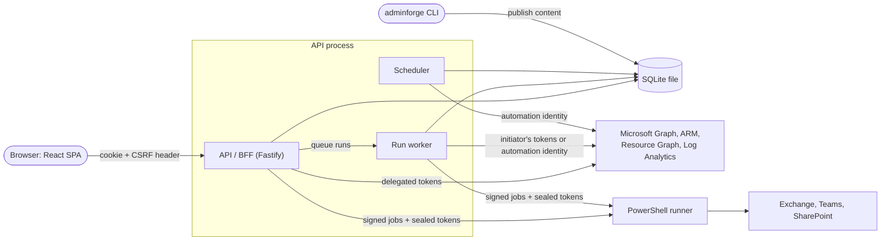

# 2. How AdminForge works

The mental model you need before changing anything. The deployed details (the pod, ports, tables) are in
[`docs/architecture.md`](../architecture.md); the reasons are in [`docs/adr/`](../adr/).

## Four ideas everything rests on

1. **The browser never holds a Microsoft token.** The API is a backend-for-frontend (BFF): the browser has an
   HttpOnly session cookie, the API holds the tokens and makes every Microsoft call (ADR-001).
2. **People act as themselves.** Interactive work uses the engineer's own **delegated** permissions, so AdminForge can
   never do more than that person could do in the Microsoft admin centers. It only adds restrictions (ADR-002).
3. **Reading is the default; writing is an event.** Read mode is default-deny for anything that isn't a read
   (ADR-003). Writing needs "armed" write access — a second, step-up sign-in to a separate Write app, time-boxed — and
   happens only through steps declared in published content.
4. **Features are content.** Pages, dashboards, reports, playbooks, runbooks, schedules, probes and connections are
   YAML in `portal/content`, validated by schemas, reviewed in git, published to the database, and rendered or executed by
   a generic engine (ADR-005). Code changes are for capabilities the content can't express.

## The moving parts

One process — the API — is also the run worker and the scheduler, and it owns the database file (ADR-016). In
production that process and the runner are the two containers of one Kubernetes pod (ADR-017).

| Part      | Code                             | Job                                                                                                       |
| --------- | -------------------------------- | --------------------------------------------------------------------------------------------------------- |
| Web app   | `portal/apps/web`                | The SPA: shell, content renderer (`/p/$key`), playbook drawer, runs, schedules, reports                   |
| API / BFF | `portal/apps/api`                | Sign-in, sessions, request policy, datasources, runs, schedules API, audit, SSE, downloads                |
| Worker    | `portal/apps/api` (`runs/`)      | Executes playbook and runbook steps from the `run_jobs` queue, in the API process                         |
| Scheduler | `portal/apps/api` (`schedules/`) | Unattended jobs as the automation identity: probes, reports, scheduled playbooks, news feeds — in the API |
| One-shots | `portal/apps/scheduler`          | Run probes or one schedule now from the command line (`--once`, `--probe`, `--schedule`)                  |
| Runner    | `portal/apps/runner`             | Pinned PowerShell scripts in single-use workers, with forwarded delegated tokens; the pod's sidecar       |
| CLI       | `portal/tools/cli`               | `adminforge` — env check, provisioning, scaffolding, validate, test, publish, audit, database backup      |

## The three identities

| Identity       | Kind        | Used for                                   | Rule of thumb                                                                      |
| -------------- | ----------- | ------------------------------------------ | ---------------------------------------------------------------------------------- |
| **Read** app   | Delegated   | Everything an engineer looks at            | Every portal user; the request policy keeps it read-only                           |
| **Write** app  | Delegated   | Changes, only while armed (Operators only) | Step-up sign-in, time-boxed; only for `mode: write` steps in published content     |
| **Automation** | Application | Unattended schedules                       | Read-only by default; never on interactive paths; scheduled writes need two people |

Portal roles (`Portal.Reader`, `Portal.Operator`, `Playbook.Approver`, `Playbook.Author`, `Portal.Admin`) are app roles
on the Read app, granted through security groups and re-checked with Entra every 5 minutes
([`docs/access.md`](../access.md)).

## What happens when…

**…an engineer opens a page.** The SPA asks the API for the page’s data (`POST /api/datasources/execute-many`,
one round trip for all of them). The API loads the published definition, checks `requires.portalRoles` and
licences, builds each datasource request from content with safely quoted parameters, sends it through the
**outbound executor** (request policy → delegated Read token → Microsoft), applies the definition's
`transform`, and returns rows. Tokens, raw upstream errors and other people's data never reach the browser.

**…an engineer changes something.** They arm write access (step-up sign-in to the Write app), open a playbook, see a
**dry-run preview** of exactly what will change, confirm, and the API enqueues a run. The worker executes the steps
with the engineer's own tokens (a restart doesn't end a run: it stops at a checkpoint and carries on afterwards);
risky playbooks need typed confirmation or a second person's **approval**. Everything is audited with the person, the
identity and Microsoft's request id. AdminForge's own apps, role groups and protected accounts are refused centrally,
and an administrator can pause all changes with the **emergency stop**.

**…a schedule fires.** The scheduler (holding the scheduler lease) runs it as the automation identity: a probe sweep,
a report export (file, email, Teams), a content-health check, a news collection, or a playbook queued for the worker.
A time missed while AdminForge was down for over an hour is recorded as a skipped run (`schedule_missed`), not run
late. Report schedules can also be created in the portal by Operators; anything that writes needs a second person's
approval before it is enabled. Probe results feed **Monitoring** (Overview), grouped by service; a check's detail says
what it found (the rows, for Operators), what to do and where to act.

**…content changes.** An engineer edits YAML, `adminforge validate` and `adminforge test` check it, a pull request is
reviewed and merged, the reviewed commit is built into the app image, and `adminforge publish` in the pod writes the
new versions to the database. The running API picks them up within a second (the `definitions_changed` signal) — no
restart. In local development the API reads the files directly with hot reload.

## Where state lives

One SQLite file holds all state (ADR-016; `DATABASE_PATH`, on a PersistentVolume in production): sessions and the
sealed token cache, published definitions, runs, the run queue and approvals, schedules and their history, probe
results, news, the hash-chained append-only audit log, preferences and settings. Outside it: the configuration (env
files; in the cluster a Secret), report files, the automation certificate. Nothing about a tenant lives in the
repository.

## Read next

[Repository map](03-repository-map.md) — where each of these parts lives and where your change goes.
